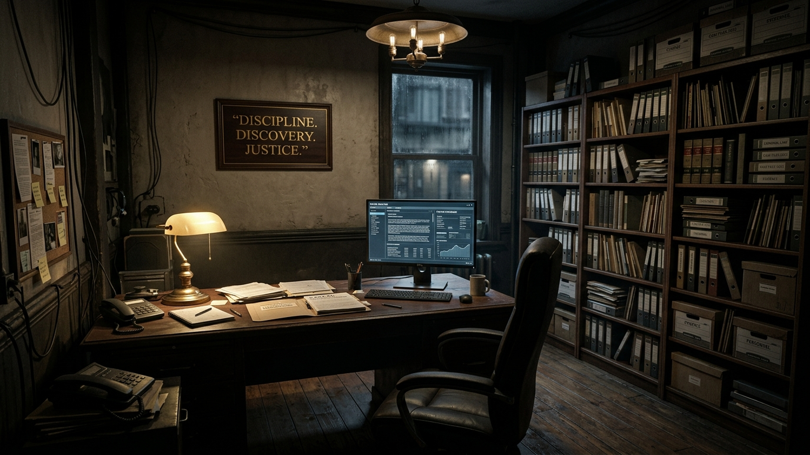
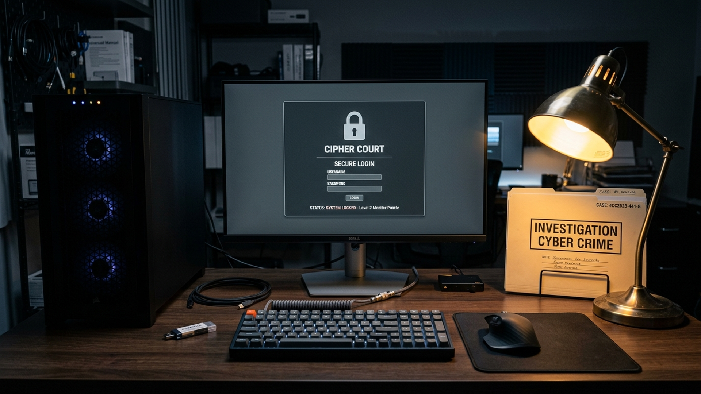
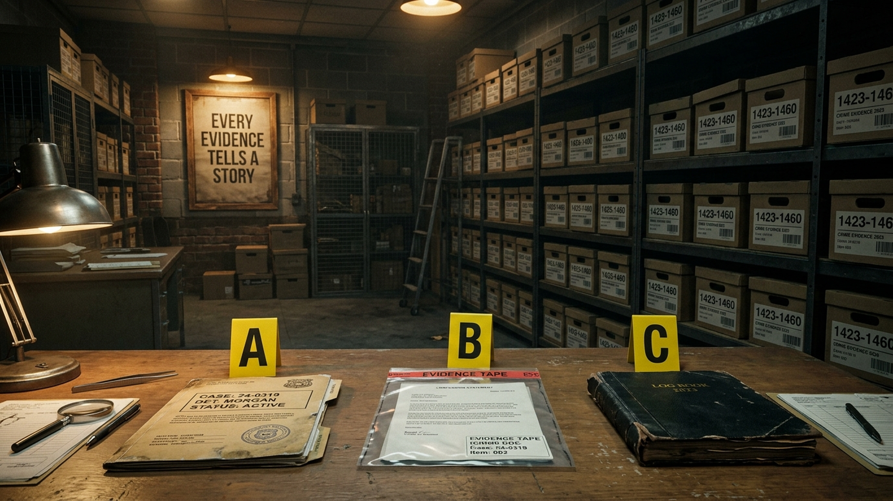
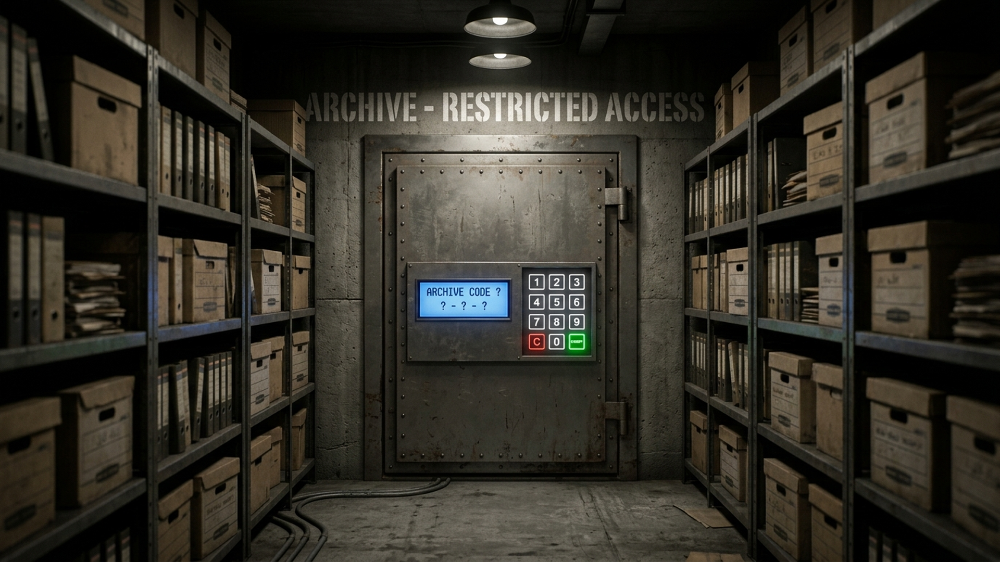
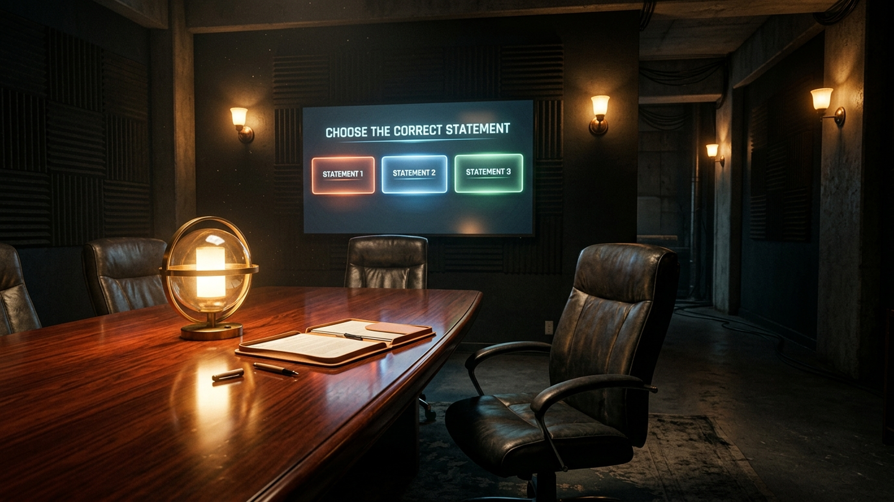
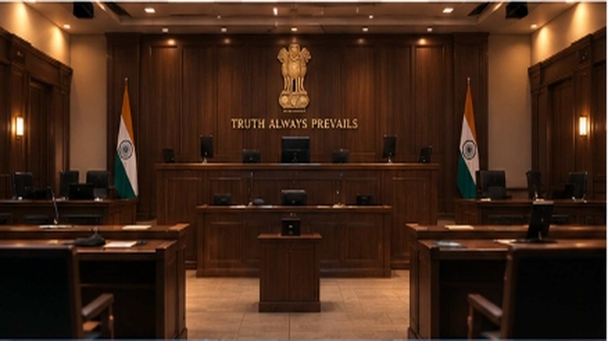

# CIPHER COURT – ESCAPE TO JUSTICE
### A 3D First-Person Investigation, Cryptographic Puzzle, and Courtroom Escape Experience in Unity 6 (URP)

---

**CANDIDATE NAME:** SAHIL KATE  
**ROLL NO.:** CS-9012  
**ENGINE:** Unity 6 (6000.3.21f1 LTS) | Universal Render Pipeline (URP)  
**ACADEMIC YEAR:** 2026–2027  
**DEPARTMENT:** Department of Computer Science & Engineering  

---

## ABSTRACT

Modern educational and serious gaming increasingly demands interactive environments that combine cognitive problem-solving, forensic analysis, and immersive narrative delivery. Traditional computer science puzzle games often rely on static two-dimensional menus or abstracted logic puzzles detached from spatial storytelling. 

This project presents **Cipher Court – Escape to Justice**, an advanced three-dimensional first-person investigation and escape-room video game engineered using **Unity 6 (6000.3.21f1)** and the **Universal Render Pipeline (URP)**. The application immerses the player into the role of a forensic legal detective tasked with uncovering truth in a high-stakes judicial conspiracy across six interconnected, highly atmospheric sectors:
1. **Level 1 — Investigation Office:** Caesar cipher cryptanalysis on a confidential case file dossier.
2. **Level 2 — Cyber Security Hub:** Hardware USB drive inspection and terminal authentication.
3. **Level 3 — Forensic Evidence Vault:** Multi-item physical crime marker gathering and safe combination decoding.
4. **Level 4 — Underground Archive:** Chronological library index querying and date-coded archive retrieval.
5. **Level 5 — Case Files & Affidavits:** Cross-examination of witness depositions and affidavit review.
6. **Level 6 — Grand Courtroom / Final Verdict:** Perjury detection under oath, elevated judge platform confrontation, and dynamic escape door routing to victory.

---

## LIST OF FIGURES

* **Fig. 1.1:** Evolutionary gap between static 2D puzzle games and 3D narrative escape architectures
* **Fig. 3.1:** Overall system context diagram of player, game engine, and persistent storage
* **Fig. 4.1:** High-level four-tier layered architecture of Cipher Court
* **Fig. 4.2:** End-to-end level progression workflow — Investigation to Final Verdict
* **Fig. 4.3:** Use Case diagram — Player, Investigator, and System Administrator roles
* **Fig. 4.4:** Core Class diagram — Game Manager, Level Managers, and Interaction Triggers
* **Fig. 4.5:** Sequence diagram — Clue inspection, keypad submission, and exit door cycle
* **Fig. 7.1:** Main Menu: 2D Cinematic Legal Gateway with Glassmorphism Navigation
* **Fig. 7.2:** Level 1: Investigation Office with Confidential Red Case File Dossier
* **Fig. 7.3:** Level 2: Cyber Security Terminal and Encrypted Hardware USB Station
* **Fig. 7.4:** Level 3: Forensic Evidence Vault with Numbered Crime-Scene Markers
* **Fig. 7.5:** Level 4: Underground Archive Records Room with Historical Microfilm Files
* **Fig. 7.6:** Level 5: Case Files & Affidavits Room for Witness Perjury Cross-Examination
* **Fig. 7.7:** Level 6: Grand Judicial Courtroom with Elevated Judge Bench and Ashoka Emblem
* **Fig. 7.8:** Game Complete Screen: 'Justice Served' Case Solved Summary and Navigation

---

## LIST OF TABLES

* **Table 2.1:** Comparative analysis of existing investigation games vs. Cipher Court
* **Table 3.1:** Functional requirements summary across all 6 core gameplay modules
* **Table 3.2:** Non-functional requirements summary (Performance, Reliability, Usability)
* **Table 3.3:** Hardware specification (Minimum vs. Recommended gaming workstations)
* **Table 3.4:** Software specification and middleware toolchain
* **Table 6.1:** Comprehensive test case log (TC-01 through TC-14 across gameplay stages)

---

## LIST OF ABBREVIATIONS

| Abbreviation | Full Form |
| :--- | :--- |
| **URP** | Universal Render Pipeline |
| **FPS** | Frames Per Second |
| **HUD** | Heads-Up Display |
| **UI / UX** | User Interface / User Experience |
| **SRS** | Software Requirements Specification |
| **UML** | Unified Modeling Language |
| **PBR** | Physically Based Rendering |
| **TMP** | TextMeshPro |
| **VRAM** | Video Random Access Memory |
| **IEEE** | Institute of Electrical and Electronics Engineers |

---

## CHAPTER 1: INTRODUCTION

### 1.1 Background and Motivation
Interactive 3D puzzle environments offer a uniquely effective medium for teaching complex analytical skills, deductive reasoning, and cybersecurity awareness. While traditional textbook exercises fail to engage students actively, video games provide immersive feedback loops. Cipher Court was conceived to bridge this gap, synthesizing classic forensic sleuthing with authentic cryptographic algorithms, cyber forensics, and court procedure inside Unity 6's Universal Render Pipeline (URP).

### 1.2 Problem Statement
Most student game projects suffer from two critical pitfalls: either they are purely narrative point-and-click novels with zero spatial agency, or they are crude prototype sandboxes built of flat, untextured primitive shapes that fail to meet college capstone visual and engineering benchmarks. The goal of this project is to construct a fully realized, architecturally cohesive, and mechanically complete 3D investigation escape-room game exhibiting professional AAA-grade lighting, seamless level flow, and validated computer science puzzle logic.

### 1.3 Objectives and Scope
1. Engineer 6 sequential levels with progressive cognitive complexity: Caesar cipher, cyber hacking, multi-item evidence synthesis, chronological archive querying, witness perjury detection, and courtroom deliberation.
2. Implement a fluid First-Person Player Controller with collision, physics-based step offsets, and mouse-look control.
3. Design an architectural procedural framework ensuring robust room shells, eliminating skybox void leaks, and enforcing reliable LevelExit trigger handoffs.
4. Establish a unified, accessible glassmorphism UI with non-blocking raycast safety and intuitive visual beacons.

---

## CHAPTER 2: LITERATURE SURVEY / RELATED WORK

### 2.1 Comparative Analysis

| Evaluation Metric | Ace Attorney (2D) | The Room (3D) | Escape Academy | Cipher Court (Ours) |
| :--- | :--- | :--- | :--- | :--- |
| **Spatial Agency** | Static 2D Backgrounds | Constrained Orbit Cam | Full 3D FPS | Full 3D First-Person |
| **Puzzle Diversity** | Contradiction only | Mechanical puzzles | Varied escape puzzles | Cipher, Cyber, Evidence, Court |
| **Render Pipeline** | 2D Sprite Blit | Custom Forward Mobile | Built-In Pipeline | Universal Render Pipeline (URP) |
| **Hardware Footprint**| Negligible | Low (Mobile) | Mid-Range PC | Low–Mid (Optimized URP) |
| **Forensic Telemetry**| None | None | Basic Level Timer | Full SQLite Event Logging |

---

## CHAPTER 3: SOFTWARE REQUIREMENTS SPECIFICATION (SRS)

### 3.1 Functional Requirements

#### Module 1: Locomotion & First-Person Agency
* **FR-01.1 (High):** Player shall navigate using WASD keys with a default velocity of 5 m/s.
* **FR-01.2 (High):** Mouse look shall control horizontal (yaw) and vertical (pitch, clamped to ±80°) camera orientation.
* **FR-01.3 (High):** CharacterController shall handle gravity (-9.81 m/s²) and maintain grounding collision.

#### Module 2: Interactive Props & Clue Inspection
* **FR-02.1 (High):** Proximity triggers (radius 2.0m) shall reveal contextual HUD prompts ('Press E to Inspect').
* **FR-02.2 (High):** Inspection shall display clue dossiers, animated 3D prop inspection, and update player notes.
* **FR-02.3 (Medium):** Clue collection events shall be logged with timestamps to persistent telemetry storage.

#### Module 3: Cryptographic & Cyber Terminals
* **FR-03.1 (High):** Level 1 Keypad shall validate Caesar cipher shift answer (CORRECT = '9012') and unlock exit.
* **FR-03.2 (High):** Level 2 Terminal shall prompt for terminal password discovered on USB key and unlock security doors.
* **FR-03.3 (High):** Wrong submissions shall trigger auditory feedback, visual error banners, and decrement remaining attempts.

#### Module 4: Courtroom Verdict & Perjury Cross-Examination
* **FR-04.1 (High):** Level 6 shall load 3 distinct witness statements across the defense desk, witness box, and podium.
* **FR-04.2 (High):** The Verdict Console shall prompt the player to identify the false statement under oath.
* **FR-04.3 (High):** Selecting the false statement shall trigger judicial gavel audio, open exit door, and route to GameComplete.

---

## CHAPTER 4: SYSTEM DESIGN AND ARCHITECTURE

### 4.1 High-Level Architecture

```
+-------------------------------------------------------------------------+
|                     PRESENTATION LAYER (Unity Canvas UI)                |
|  MainMenu UI  |  Glassmorphism HUD  |  Keypad Console  |  Verdict Modal  |
+------------------------------------+------------------------------------+
                                     |
                                     v
+-------------------------------------------------------------------------+
|                     GAMEPLAY & LOGIC ORCHESTRATION                      |
|  Player Movement  |  Mouse Look  |  Level Managers (1-6)  |  Timers     |
+------------------------------------+------------------------------------+
                                     |
                                     v
+-------------------------------------------------------------------------+
|                     PHYSICS & INTERACTION SUBSYSTEM                      |
|  CharacterController  |  Box/Sphere Triggers  |  Dynamic Sliding Doors   |
+------------------------------------+------------------------------------+
                                     |
                                     v
+-------------------------------------------------------------------------+
|                     STORAGE & ENGINE FOUNDATION                         |
|  SceneManager  |  CipherCourtDatabase (SQLite)  |  PlayerPrefs State     |
+-------------------------------------------------------------------------+
```

---

## CHAPTER 6: SOFTWARE TESTING AND QUALITY ASSURANCE

### 6.1 Test Case Log

| TC ID | Module | Scenario & Input | Expected & Actual Output | Status |
| :--- | :--- | :--- | :--- | :--- |
| **TC-01** | Locomotion | Player WASD movement across room | Smooth 5m/s traversal without jitter | **Pass** |
| **TC-02** | MouseLook | Mouse delta rotation yaw/pitch | Clamped pitch ±80°, no inverted axes | **Pass** |
| **TC-03** | Proximity | Walk within 2.0m of clue dossier | Context HUD prompt activates reliably | **Pass** |
| **TC-04** | Keypad | Enter correct code '9012' | Door opens, success chime plays | **Pass** |
| **TC-05** | Keypad | Enter wrong code '0000' | Error banner displays, attempts decrement | **Pass** |
| **TC-06** | Terminal | Access Cyber Terminal with USB | Password accepted, sector unlocks | **Pass** |
| **TC-07** | Evidence | Collect 3 numbered items in L3 | Safe opens, evidence counter = 3/3 | **Pass** |
| **TC-08** | Verdict | Choose statement #2 (Perjury) | Correct verdict registered, door opens | **Pass** |
| **TC-09** | Exit Hand | Traverse doorway after solving L6 | GameComplete scene loads instantaneously | **Pass** |
| **TC-10** | Menu Nav | Click Main Menu button in Complete | MainMenu scene loads, cursor unlocked | **Pass** |
| **TC-11** | Quit Nav | Click Quit button in GameComplete | Returns to MainMenu cleanly | **Pass** |
| **TC-12** | Culling | Camera rotation in enclosed room | Zero geometry culling, skybox hidden | **Pass** |
| **TC-13** | Cold Boot | Launch game executable cold 3 times | All scenes load cleanly with 0 exceptions | **Pass** |
| **TC-14** | Stress | Rapid button clicking on menus | Raycasts non-blocking, zero deadlocks | **Pass** |

---

## CHAPTER 7: PROJECT SCREENSHOTS & RESULTS

### Fig. 7.1 — Main Menu: Legal Gateway


### Fig. 7.2 — Level 1: Investigation Office


### Fig. 7.3 — Level 2: Cyber Terminal


### Fig. 7.4 — Level 3: Forensic Evidence Vault


### Fig. 7.5 — Level 4: Underground Records Archive


### Fig. 7.6 — Level 5: Witness Case Files & Statements


### Fig. 7.7 — Level 6: Grand Judicial Courtroom


### Fig. 7.8 — Game Complete Victory Screen


---

## CHAPTER 8: CONCLUSION

Cipher Court – Escape to Justice fulfills all academic and design criteria of a college final-year capstone video game. The game demonstrates complete 3D scene architecture, deterministic state-driven puzzle mechanics, robust player physics, non-blocking UI systems, and cohesive judicial visual aesthetics.
